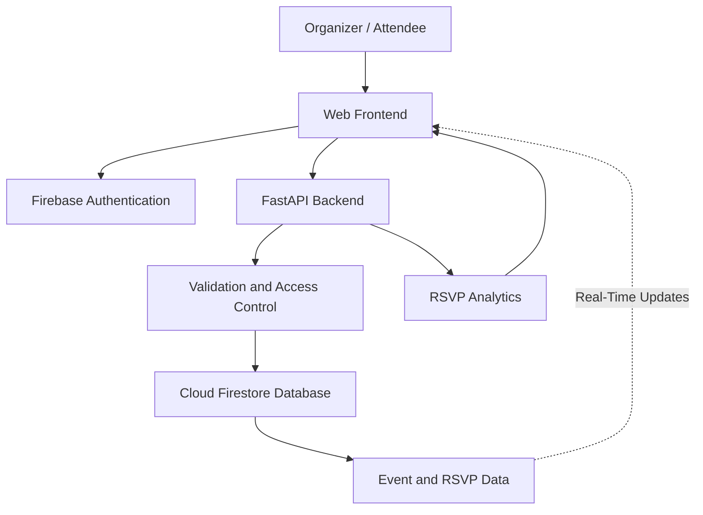

# ☁️ CloudSync
### Real-Time Cloud-Based Event Planning & RSVP Tracker

**Plan Smarter. Connect Faster. Track Events in Real Time.**

CloudSync is a cloud-based event management project designed to help organizers manage events and attendees track their RSVPs from one platform.

## 🎯 Project Overview

Managing events manually can make it difficult to track attendees, update event details, and calculate participation.

CloudSync aims to simplify this process by providing event management, RSVP tracking, authentication, and real-time updates.

## ✨ Key Features

- **Event Management:** Create, edit, and cancel events.
- **User Login:** Support organizer and attendee accounts.
- **RSVP Tracking:** Respond with Going, Maybe, or Not Going.
- **Real-Time Updates:** Keep event and RSVP information updated.
- **Event Analytics:** Display RSVP counts and participation statistics.
- **Announcements:** Share important event updates.
- **Role-Based Access:** Provide different permissions for organizers and attendees.

## 🏗️ System Architecture

The diagram below shows how the main parts of CloudSync are planned to work together.

**Simple explanation:**
- **Frontend:** The website users interact with.
- **Firebase Authentication:** Handles user login.
- **FastAPI Backend:** Processes event and RSVP requests.
- **Cloud Firestore:** Stores event and RSVP information.
- **RSVP Analytics:** Calculates and displays participation statistics.

## 🛠️ Technology Stack

| Technology | Purpose |
|---|---|
| HTML, CSS, JavaScript | Website frontend |
| Python | Backend programming |
| FastAPI | REST APIs |
| Firebase Authentication | User login |
| Cloud Firestore | Cloud database |
| Pytest | Testing |
| GitHub | Version control and project documentation |

## ☁️ Cloud Computing Concepts

- Cloud database
- Authentication and access control
- REST API architecture
- Real-time data synchronization
- Scalability and error handling
- Cloud deployment and testing

## 🚀 Development Roadmap

1. Set up the project structure.
2. Develop the backend APIs.
3. Implement event management and RSVP tracking.
4. Build the frontend website.
5. Integrate Firebase Authentication and Firestore.
6. Add analytics and real-time updates.
7. Test and deploy the application.

## 🔐 Security

The project will use authentication, role-based authorization, input validation, and database security rules. Synthetic users and sample events will be used during development.

## 📸 Screenshots and Demo

Screenshots and a live demo will be added after implementation and deployment.

## 📌 Project Status

**Status: Initial Development**

Features will be marked complete only after implementation and testing.

---

*CloudSync — Connecting people, events, and real-time information through the cloud.*
## 🌐 Live Demo

- **Frontend:** [Open CloudSync Website](https://cloudsync-event-rsvp-frontend.onrender.com)
- **Backend API:** [Open CloudSync Backend](https://cloudsync-event-rsvp-tracker.onrender.com)

## 🚀 Deployment

- Frontend hosted on Render Static Site.
- Backend hosted on Render Web Service.
- Firebase Firestore used for cloud data storage.
